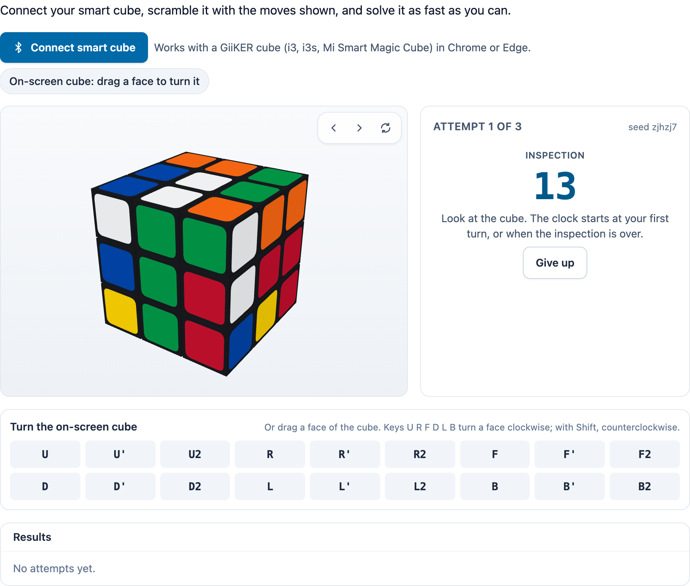

# tspci-smart-cube

> [!WARNING]
> **Experimental (alpha). Just for inspiration.** This PCI is a technical showcase, made by software developers. Its
> scoring has not been checked by assessment specialists, it has never been used in an assessment, and it has only
> been tested without a real smart cube (see [Testing](#testing)). It is offered as is, without any warranty.

A QTI 3 Portable Custom Interaction (PCI) for solving a Rubik's-type cube against the clock. The candidate connects a
GiiKER smart cube over Bluetooth, or turns the cube on the screen with the mouse. The PCI shows the cube in 3D as it
is turned, gives a scramble from a seed and guides the candidate through it, and once the cube is scrambled the
candidate presses Start: an inspection countdown, then a timer that stops when the cube is solved. Made with
[tspci](https://github.com/Citolab/tspci).

**[Try it in your browser](https://marcelh1983.github.io/tspci-smart-cube/)**: the demo page runs the PCI on its own,
with the on-screen cube or a GiiKER cube (Chrome or Edge). Add `?seed=…` to the address to share the same scrambles, `&top=yellow` to hold it with yellow on top.
The page is `demo/index.html`, published to GitHub Pages by `.github/workflows/pages.yml` on every push to `main`.

<p align="center">
  
</p>

## What it does

- **A smart cube over Bluetooth**: *Connect smart cube* opens the browser's own list of Bluetooth devices. A GiiKER
  cube (i3, i3s, Mi Smart Magic Cube; names starting with `Gi`, `Mi Smart` or `Hi-`) sends its state on every turn;
  the PCI decodes it (also the encrypted messages of newer firmware) and shows the cube in 3D, each turn animated.
  The stickers the cube reports count, not a count of turns, so a missed message never gets the PCI out of step.
- **Or the cube on the screen**: without a smart cube connected, the candidate turns the cube on the screen. Drag a
  sticker to turn its face (mouse or finger); drag next to the cube to turn the view. There are also 18 buttons
  (U, U′, U2 … B2) and keys: U R F D L B turn a face clockwise, with Shift counterclockwise. `data-allow-virtual="false"`
  turns this off, for an item that needs the real cube.
- **A scramble from a seed**: `data-seed` gives every candidate the same scrambles (attempt 1 uses the seed, attempt 2
  `seed-2`, and so on). Without a seed, each candidate gets a seed of their own, kept in the state, so a reload gives the
  same scramble. The scrambles are random turns, `data-scramble-length` of them (20 by default), never the same face
  twice in a row and not R L R.
- **A guide through the scramble**: the moves as chips, done ones struck through, the next one highlighted, and what to
  turn now: "Next: R2". A half turn can be made in quarter turns either way. A wrong turn gives "Undo: L′"; the guide
  simplifies the turns to undo (R then R is R2, R L R′ is L). A cube that was not solved at the start gets "Solve it
  first". The cube as it should become is shown unfolded.
- **Start, inspection, solve**: once the cube is scrambled, *Start* (or the space bar) starts `data-inspection`
  seconds of inspection (15, as at a WCA competition; 0 for none). The clock starts at the first turn, or by itself
  when the inspection is over. It stops when the cube is solved and shows the time, the number of turns and the turns
  per second. *Give up* ends an attempt as DNF.
- **Attempts**: `data-attempts` (3 by default); the results table shows every attempt with its time, turns and
  scramble, and the best time.
- **Accessible**: everything has a name, the phases are announced in a live region, the 3D view turns with the arrow
  keys, and the on-screen cube can be turned with buttons and keys. Without WebGL the cube is shown unfolded.
- English and Dutch (`data-language`).

## What can be configured

| attribute | default | what |
| --- | --- | --- |
| `data-prompt` | (an instruction) | the instruction above the cube; the default is translated with `data-language` |
| `data-seed` | (empty) | the seed of the scrambles; empty: a seed per candidate |
| `data-scramble-length` | `20` | turns in a scramble (5–40) |
| `data-inspection` | `15` | seconds of inspection before the clock starts by itself (0–60; 0: none) |
| `data-attempts` | `3` | number of attempts (1–12) |
| `data-target-time` | `0` | seconds: a solve this fast or faster scores 1; 0: any solve scores 1 |
| `data-allow-virtual` | `true` | the on-screen cube when no smart cube is connected |
| `data-top` | `white` | the colour on top, green in front: `white`, or `yellow` (the cube turned over, as many speedcubers hold it; scrambles, the guide and the solution are as seen so, and a GiiKER cube's turns are read so) |
| `data-height` | `380` | height of the 3D view in pixels |
| `data-language` | `en` | `en` or `nl` |

## The response and scoring

Nothing until the first attempt ends. Then a `record` (`"scoring": ["custom", "human"]`):

| field | base type | what |
| --- | --- | --- |
| `score` | integer | 1 for a solve, or with `data-target-time` for a solve that fast; otherwise 0 |
| `maxscore` | integer | 1 |
| `time` | float | the fastest solve in seconds (absent without a solve) |
| `moves` | integer | the turns of the fastest solve |
| `solved` | integer | the number of solves |
| `attempts` | integer | the number of attempts finished |
| `seed` | string | the seed of the scrambles |
| `device` | string | `giiker`, `virtual` or both (`giiker;virtual`) |
| `results` | string | every attempt as JSON: seed, scramble, time (ms, null for DNF), moves, inspection (ms), solution, device, top (only when `yellow`) |

Response processing can use `score`, or set its own limits on `time`; an item that needs the real cube can check
`device`. The `results` field brings the attempts back with `setResponse`.

## Using it

Web Bluetooth works in Chrome and Edge on a computer or an Android phone, not in Safari or Firefox (there the PCI says
so, and the on-screen cube still works). The page has to be secure (https or localhost), and a PCI in an iframe of
another origin needs `allow="bluetooth"` on that iframe. A delivery system that does not allow it gets a clear
message. The Bluetooth connection ends when the PCI is removed (`oncompleted`).

``` sh
npm i
npx playwright install chromium   # once, for the stories
npm run dev           # the PCI in a page, with a GiiKER or the on-screen cube
npm test              # the cube, scrambles, the guide and the GiiKER decoder in node
npm run storybook     # the stories, with their tests in the interactions panel
npm run test:stories  # the stories in Chromium, with the on-screen cube
npm run prod          # all tests, then the bundle in dist/
npm run package-qti3  # a zip to import in a QTI 3 delivery system, such as qti.citolab.nl
npm run package-tao   # a zip to add as a Portable Custom Interaction in TAO
```

`npm run dev` picks a free port when 8080 is taken: use the address it prints after "Serving".

## Testing

There is no smart cube in a test. The node tests (`test/giiker.test.ts`) make GiiKER messages from the 3×3×3 puzzle
definition of [cubing.js](https://github.com/cubing/cubing.js) and its mapping between GiiKER and Reid order (data in
the test only, not in the PCI), and check that our decoder, which follows
[hakatashi/giiker](https://github.com/hakatashi/giiker), and our own face turns give the same stickers after every turn
of long scrambles, for plain and encrypted messages. Two independent sources agree, but the PCI has not been tried with
a real cube yet.

## Credits

The Bluetooth protocol of the GiiKER cube is not published. The PCI uses what others found out, rewritten in
`src/cube.ts`:

- [hakatashi/giiker](https://github.com/hakatashi/giiker) by Koki Takahashi (MIT): the service and characteristic,
  the layout of the message (corners, edges, their orientation, the last turns) and how pieces and orientations become
  colours.
- [cubing.js](https://github.com/cubing/cubing.js) by Lucas Garron and contributors (MPL-2.0 OR GPL-3.0-or-later):
  the decryption table of newer firmware and the names of the devices.

These are libraries, not PCIs; the PCI takes no code from them and is MIT licensed (see [LICENSE](./LICENSE)).
Built with [tspci](https://github.com/Citolab/tspci); the Storybook setup in `.storybook/` comes from
[tspci-examples](https://github.com/Citolab/tspci-examples).
